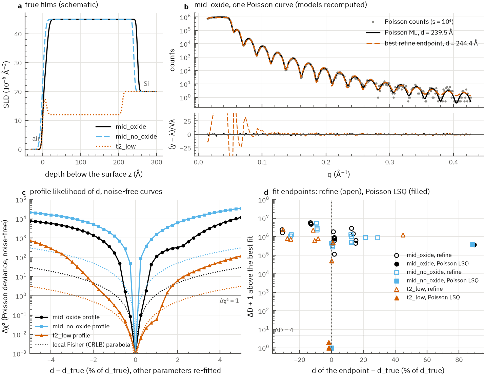

# ReflectoLearn

[](https://github.com/NaNIsaac-Research/ReflectoLearn/actions/workflows/ci.yml) [](LICENSE)

**Thin-film thickness, roughness and SLD from one X-ray reflectivity curve: a CNN guess, then a differentiable Abeles fit.**


A synthetic curve (grey; 240 Å film, roughness 6 Å, SLD 45×10⁻⁶ Å⁻², on a 12 Å oxide over Si, with footprint,
resolution, background and Poisson noise), the CNN's starting guess (blue, dashed) and the
gradient-refined fit through the same Abeles engine (red), from `reflectolearn predict`.

A 1D CNN trained on simulated curves guesses the film; a staged gradient fit through a differentiable Abeles simulator (PyTorch) refines the guess against the data. How it works, every command, the GenX fit and the configuration: [docs/usage.md](docs/usage.md).

## Install

Uses [uv](https://docs.astral.sh/uv/); Python 3.12 or newer.

<!-- test -->
```bash
git clone https://github.com/NaNIsaac-Research/ReflectoLearn.git
cd ReflectoLearn
uv sync
uv run reflectolearn --help
```

The last line prints the command list and exits with an error if the install is broken. On Windows, `torch` is taken from the PyTorch CUDA 12.8 index; other platforms use the default PyPI wheel.

## Quick start

```bash
uv run reflectolearn config --out config.yaml
uv run reflectolearn train --config config.yaml
uv run reflectolearn predict measured.txt -k path/to/best.pt   # 2 columns: 2θ or q, intensity
```

`predict` writes `<name>_predict.png` and `<name>_predict.txt` next to the input. Evaluation, tuning, stitching, the benchmark and the ONNX export are in [docs/usage.md](docs/usage.md#commands).

## Tests

```bash
uv sync --extra genx --extra mcmc --extra onnx
uv run pytest
```

The two GenX tests are skipped without the `genx` extra, the emcee test without the `mcmc` extra, and the ONNX tests without the `onnx` extra.

## Validation

The validation so far is **synthetic only**. No measured data ships with the repository.

- `examples/synthetic_film_fit/` simulates counts from a known film with an independent Parratt engine. It then runs them through the fit path that `reflectolearn predict` uses after its network, and compares the result with the known film. `expected.json` keeps the truth (with tolerances) apart from a regression snapshot, and `tests/test_example_synthetic_film_fit.py` checks both.
- Known limit found by the example: on data with no angular offset, the default `refine` moves the 2θ offset towards its bound and the film SLD comes out about 30% low ([#14](https://github.com/NaNIsaac-Research/ReflectoLearn/issues/14)). The SLD and roughness checks are strict expected failures until that is fixed. The thickness is right.
- Measured XRR curves have not been validated yet.

## Research

The repository also holds a series of registered experiments on synthetic curves. Each has a
registration written before its run, run records, a report built by a script from those records,
and a verdict from the registered rules. The index with every file, verdict and command is
[`docs/research/README.md`](docs/research/README.md).



Experiment 001 on synthetic single films (from `docs/identifiability/nonunique_tables.md`). (a) On noise-free data the deviance has one sharp minimum at the true thickness d for all three cases, so d is determined. (b) On one noisy curve per case, all 48 refine endpoints (open circles) stop at least 4.9×10⁴ in deviance above the best fit, with d from −31 % to +45 %, while 43 of 45 Poisson least-squares fits from the same starts (filled) reach it. (c) The best refine endpoint misfits the low-q fringes that the maximum-likelihood fit matches.

- **Identifiability (001).** Whether wrong single-film fits come from the optimizer or from missing
  information. Within refine's bounds the three test films are identifiable, so refine's wrong fits
  are optimizer failures (#25).
- **Fit policy (002, 003, 004).** Whether a scripted fitting protocol (layer count, which parameters
  to open, when to stop) beats a full fit of every layer count, and why its extra layers fail on
  held-out points. It does not beat the full fit (002); the extra layers compensate for a wrong
  start basin (003); better starts did not remove them (004).
- **Fisher information against global fits (005).** Whether local Fisher information describes what
  a global fit can tell apart. Partly: the low-q share of the discrimination and the overdispersion
  of repeated scans are supported, the Fisher-ratio hypothesis is unresolved.

| # | Experiment | Verdict |
|---|---|---|
| 001 | identifiability | optimizer failures within refine's bounds |
| 002 | fit policy X2a/X2b | no room for a learned policy |
| 003 | fit policy X2d | wrong-basin cause supported; protocol pass not attributable |
| 004 | fit policy X2e | fail; basin reading supported |
| 005 | Fisher against global fits | H-F unresolved; H-W2, H-cal2, H-BM1 supported |

The commits each registration cites are tagged `frozen/exp…`; result files too large for the
repository are in the release `research-data-1`.

## Citation

See [CITATION.cff](CITATION.cff).

## License

MIT, see [LICENSE](LICENSE).
