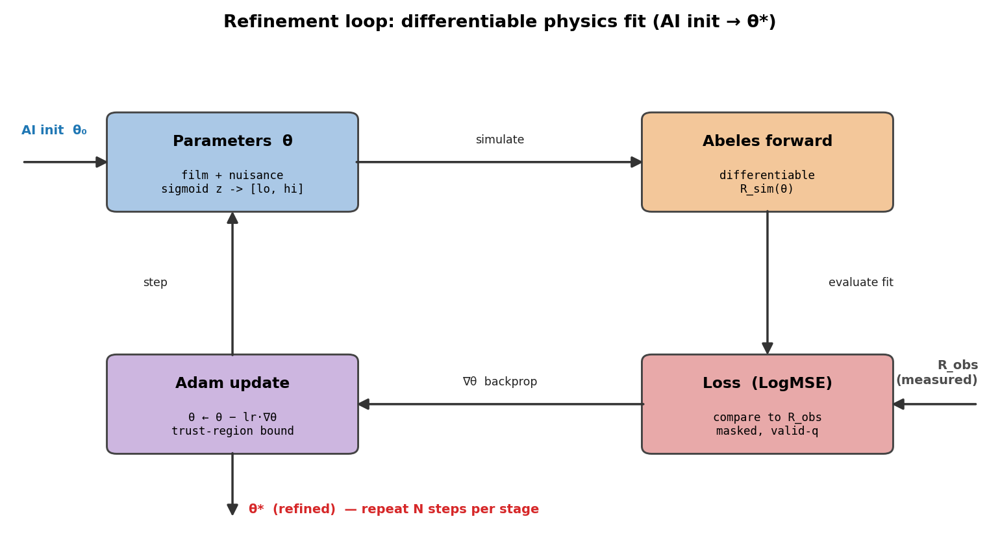
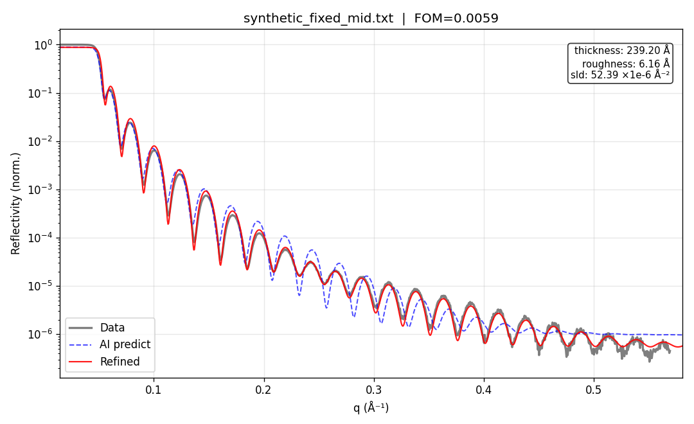

# Refinement

The CNN's guess is a starting point. `reflectolearn.refine.refine` fits it to the measured curve by
gradient descent (Adam) through the same Abeles engine the training data come from, so every
parameter of the forward model, film and instrument, can be moved by the data.

Each parameter is optimized as a latent variable mapped through a sigmoid onto its bounds, so it
stays inside them throughout. The film parameters (thickness, roughness, SLD) are bounded by a
trust region around the CNN's guess: half-width `trust_margin` (default 0.4) times the larger of
the guess and 10% of the parameter's range, clipped to the global range in `param_ranges`. The
other parameters use fixed global bounds from `RefineConfig`.

A synthetic 240 Å film (roughness 6 Å, SLD 45×10⁻⁶ Å⁻², on a 12 Å oxide over Si) with footprint,
resolution, background and Poisson noise; the CNN's start (blue, dashed) and the refined fit (red),
from `reflectolearn predict`.

## What is fitted

Besides the three film parameters, the fit carries nuisance parameters: effects that change the
curve but are not of interest. Fitting them stops a mismatch in the forward model from being
absorbed by the film parameters.

| key | effect | `RefineConfig` flag | default |
|---|---|---|---|
| `i0` | intensity scale | `fit_i0` | on |
| `bkg` | background, log10 | `fit_bkg` | on |
| `tth_offset` | 2θ zero offset, ±0.08° | `fit_tth_offset` | on |
| `dq` | Gaussian resolution, constant σ_q | `fit_dq` | on |
| `dq_rel` | q-proportional resolution, σ(q) = √(dq² + (dq_rel·q)²) | `fit_dq_rel` | off |
| `kalpha2_ratio` | Cu Kα2 doublet | `fit_kalpha2` | on |
| `footprint` | low-angle footprint attenuation, erf(s·sin θ) | `fit_footprint` | on |
| `oxide_*` | native-oxide layer on top of the film | `fit_oxide` | on |

The substrate is not fitted. `predict` fixes it to the middle of the config's `substrate` range.

The oxide thickness and `dq` carry an L2 penalty towards their "off" value (`nuisance_reg`, default
0.2), so they turn on only as far as the data need. With `fit_dq_rel` on, `dq` is not penalized.

## Stages

The default `RefineConfig().stages`:

| stage | parameters | loss | steps | lr |
|---|---|---|---:|---:|
| `1.scale` | i0, bkg, tth_offset, footprint | linear MSE | 120 | 0.05 |
| `2.structure` | thickness, sld, tth_offset | correlation | 200 | 0.03 |
| `3.fine` | everything above plus roughness, dq, dq_rel, kalpha2_ratio, oxide | log10 MSE | 300 | 0.01 |

Before the stages, `i0` and `bkg` alone are fitted with the film held at the CNN's guess, and the
log10 MSE at that point is reported as `fom_before`. `fom_after` is the log10 MSE at the end, so the
difference measures what the film parameters gained, not the scale matching.

## From the command line

`reflectolearn predict` refines by default. Its options for the fit:

| option | what it does |
|---|---|
| `--no-refine` | skip the fit, report the CNN's guess |
| `--trust-margin` | trust-region half-width ratio (default 0.4) |
| `--alias-check` | experimental: also refine from half and twice the CNN thickness and from the thickness of the fringe period, then pick by fit quality plus a prior on the fringe period |
| `--mcmc-steps N` | sample the posterior around the fit with emcee for N steps (needs the `mcmc` extra) |

`reflectolearn evaluate --refine --trust-margin 0.4` runs the same fit on fresh simulated curves and
reports metrics before and after it.

## From Python

The options below have no command-line flag.

- `RefineConfig(tth_offset_last_stage=True)` fits the 2θ offset only in the last log10-MSE stage
  that lists it, and also refits from that stage with the offset held at 0. The comparison is in
  `info["offset_off"]`, and a warning is logged when holding it at 0 fits better.
- `RefineConfig(fit_dq_rel=True)` adds the q-proportional resolution term.
- `RefineConfig.likelihood(counts_scale)` replaces the stages with `likelihood_stages()`: no
  correlation stage, a Poisson deviance instead of the log10 MSE, two polishing stages at lr 1e-3
  and 1e-4, and about 30 times the default number of steps. It reaches the Poisson maximum-likelihood
  fit on counting data; use it on raw counts at the measured q points, not on a curve interpolated
  onto the model grid.
- `refine_multistart` is what `--alias-check` calls. `fft_thickness` alone gives the thickness of the
  Kiessig fringe period, independent of the network.
- `reflectolearn.refine.mcmc.sample_posterior` is what `--mcmc-steps` calls.
- `reflectolearn.staged_refine.refine` takes the same arguments and runs the same strategy on
  [ReflectoFit](https://github.com/NaNIsaac/ReflectoFit)'s staged optimiser and float64 forward
  model. Given `forward=make_forward` it reproduces `refine` (tests to 1e-6). Its own forward model
  computes the resolution term with a fixed number of nodes per point, which is not yet accurate at
  the critical edges of non-absorbing films
  ([ReflectoFit#6](https://github.com/NaNIsaac/ReflectoFit/issues/6)). The command line still calls
  `refine`.

## Known limits

These are open issues, found on synthetic curves:

- With no angular offset in the data, the default fit moves the 2θ offset towards its bound and the
  SLD comes out up to 30% low; the offset and the SLD are almost perfectly correlated, and the
  `2.structure` stage slides along that valley
  ([#14](https://github.com/NaNIsaac/ReflectoLearn/issues/14)). Thickness is not affected.
  `tth_offset_last_stage` is the opt-in mitigation; it is off by default.
- With the default stages, the fit stops short of the best fit even on curves from its own forward
  model ([#25](https://github.com/NaNIsaac/ReflectoLearn/issues/25)). `RefineConfig.likelihood` is
  the opt-in path that reaches it, at about 30 times the cost.
- The posterior sampler's chains are often far shorter than 50 autocorrelation times with all twelve
  parameters free ([#29](https://github.com/NaNIsaac/ReflectoLearn/issues/29)). The result reports
  the autocorrelation time and a warning is logged; read the intervals with that in mind.

The [synthetic film example](../examples/synthetic_film_fit/README.md) shows the first limit on one
known film and lists what that example does not cover.
