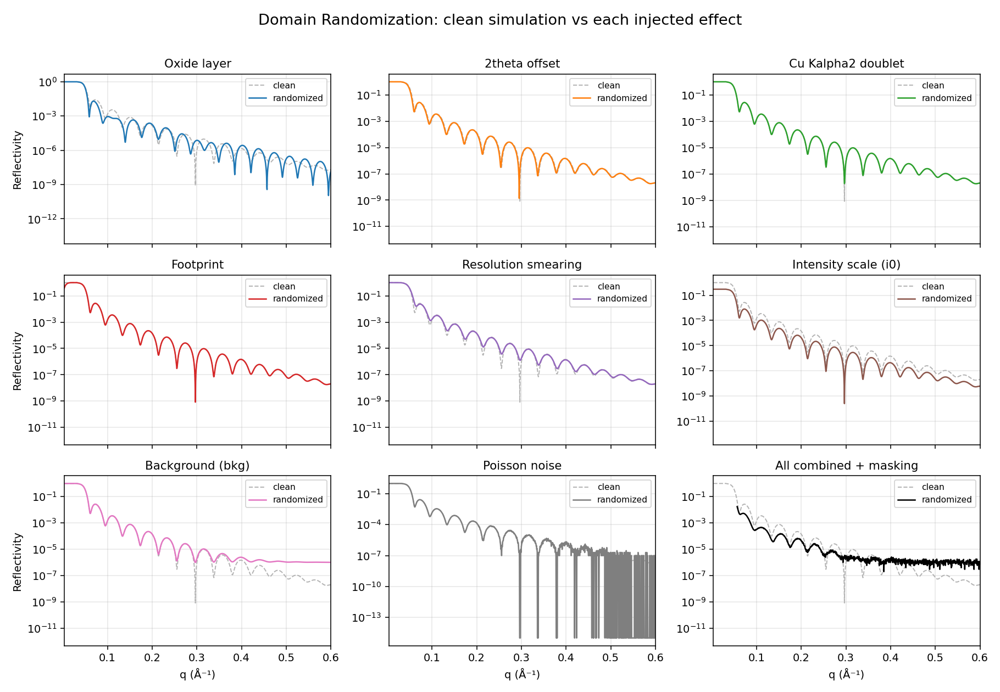
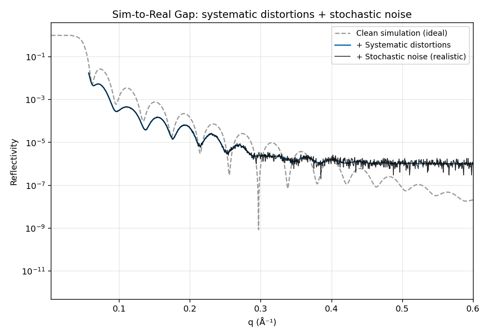
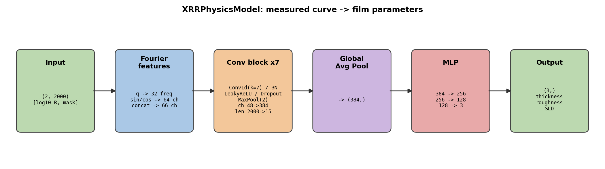

# Training data and network

The CNN never sees a measured curve during training. Every batch is simulated on the fly, so there
are no dataset files: `reflectolearn train` draws film and substrate parameters, computes `R(q)` with
a batched Abeles transfer-matrix engine (Névot-Croce roughness, complex SLD), and distorts the curves
the way an instrument would. The ranges below are the defaults in `reflectolearn/config.py`, which
`reflectolearn config` writes out; every one can be changed in the config file.

## What is drawn

Uniformly, per curve:

| | range |
|---|---|
| film thickness | 10–1200 Å |
| film roughness | 0–15 Å |
| film SLD | 5–100 ×10⁻⁶ Å⁻² |
| substrate SLD | 18–22 ×10⁻⁶ Å⁻² (Si is about 20) |
| substrate roughness | 1–6 Å |

The curve covers 2θ = 0.05–15° at 1.54 Å on 2000 q points. The network predicts the three film
parameters; the substrate is simulated but not predicted.

## Domain randomization

A curve simulated from the film alone is cleaner than any measurement. To make the network robust to
the difference, the generator and the augmentor add effects it is not asked to predict:

In the forward model, per curve (`augmentation` section of the config):

- a native-oxide layer on top of the film, present with probability 0.7, 0–40 Å thick, SLD 5–25;
- a 2θ zero offset of ±0.02°;
- the Cu Kα2 doublet, with a Kα2/Kα1 ratio drawn from 0–0.5.

Then instrument effects, each switched on for a batch with probability `prob` (0.9):

- footprint attenuation at low angle (beam width 0.005–0.015 mm, sample length 5–30 mm);
- Gaussian resolution smearing, σ_q = 0.0001–0.006 Å⁻¹;
- intensity scale 0.8–1.2 and a background of 10⁻⁸–10⁻⁵;
- Poisson counting noise at 10⁵–10⁸ counts at R = 1;
- up to 5% of the points cut at each end of the curve, recorded in a mask.

The curve is then normalized to its maximum and taken as log10; the masked points are set to a fixed
floor so the network sees one consistent "no data" value.

## Engine

`simulation.engine` picks how the curves are computed from the same draws. `legacy` (the default)
is the Abeles engine above in complex64 with the augmentor's convolution on the q grid.
`reflectofit` computes them with [ReflectoFit](https://github.com/NaNIsaac/ReflectoFit) in float64,
with footprint and resolution inside the forward model at `simulation.resolution_nodes` nodes per
point; `reflectolearn train` writes the engine and the error of that node count to
`data_engine.json` in the run directory. Without resolution the two engines differ only by the
precision of the legacy engine (up to 7 % in deep minima of thick films, median 5e-5).
With resolution, a fixed node count is not yet accurate at the critical edges of non-absorbing
films (0.26 relative at 27 nodes, 0.037 at 61), so do not train on it until ReflectoFit#6 is fixed.

A seed reproduces a batch only on the same engine and settings: torch.poisson draws a number of
random numbers that depends on the expected counts, so any change to the curves moves every draw
made after the counts (the mask, and the following batches).

## The network

`XRRPhysicsModel` takes two channels, the log10 curve and its mask, adds random Fourier features of q,
runs a stack of 1D convolution blocks (kernel 7, batch norm, LeakyReLU, dropout, max-pool by 2;
channels double up to eight times the first), averages over q and maps the result to the three
normalized film parameters with a small MLP. Training minimizes the MSE on those normalized values.

The diagram is drawn from the repository's `config.yaml` (48 channels, depth 7, MLP width 256, the
dimensions of the trained model). The code defaults that `reflectolearn config` writes are 64
channels, depth 6 and MLP width 512; `python -m reflectolearn.report.figures` redraws the diagram for
whatever `config.yaml` it finds in the current directory.

## What this does not cover

The training curves are one film, an optional oxide and a substrate, from the same physics family as
the fit. Interdiffusion, density gradients, multilayers, a non-Gaussian beam and detector
nonlinearity are not simulated, so a measured curve with them is outside what the network has seen.
